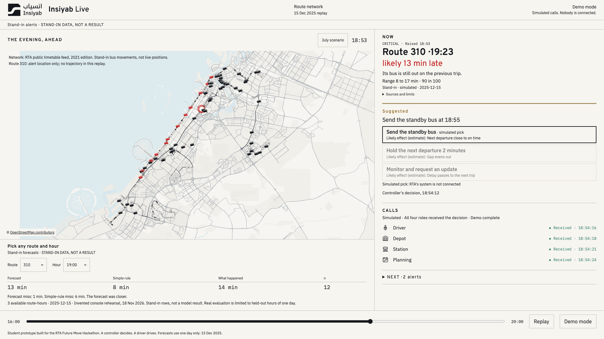
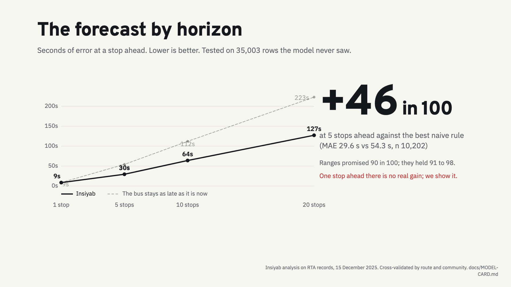
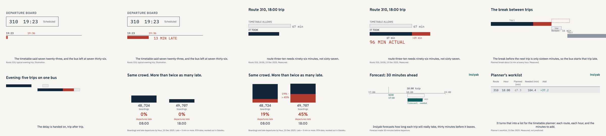

# Insiyab integration, public journey and presentation review

19 November 2026. Public target: https://insiyab.amirkazemkhani.com. Source checkout: d2ed2e6; public deployment c258552, bundle fixtures, fixture true. These were checked during this audit. Deployment stayed stable throughout the automated persona run. No deployment, phone call, relay request or external write was made by the audit.

## Verdict

The console demo works and has careful human-decision boundaries. The pilot concept has practical value: anticipate operational risk, prepare options and reduce coordination burden while a controller decides. The presentation is not ready to defend its headline accuracy claim. Its central lateness result is taken from invented data but presented as an RTA-records result. Fixing that evidence boundary matters more than additional visual polish.

This is my assessment through five simulated reviewer perspectives, not feedback from actual RTA officials, a named Sheikh, or five independent human testers. The criteria come from docs/REQUIREMENTS.md section 4: five criteria worth 20 points each, with 60 points concerning forecasting novelty, model quality and accuracy. No competition score or approval is claimed.

## Integration status

- `git pull --rebase origin main`: already up to date at d2ed2e6 when review began.
- GitHub's paginated branches API and `git ls-remote` both returned only main (d2ed2e6) and imgbot (64e6874).
- All PR states were checked. Only PR #1, [ImgBot image optimization](https://github.com/Kazemkhani/insiyab/pull/1), was returned. It is unrelated to Mustafo's model/watchers work and changes screenshots/brand/deck images; it was not merged.
- GitHub's forks API returned no accessible forks. This checkout has one local worktree, on main. This does not reveal unpublished work on Mustafo's machine or an inaccessible fork.
- No v2 implementation entries exist in coordination/v2-C.md or v2-D.md. No v2 model/watcher changes were found in the checked main history; the relevant 18 November commit was the plan, 9b8a6a7.
- artifacts/forecast/judge_pick.json, fixtures/watchers/alerts.json and artifacts/watchers/heat_stops.json are absent. The console correctly uses its labelled local stand-ins.
- There is no pushed Mustafo v2 work to merge in the accessible repository. The existing deck and pitch branches were already merged into main by lane 1. Integration remains dependent on Mustafo pushing his work and identifying its branch/PR.

## Current-run evidence

Command:

```sh
~/dev/insiyab/.venv/bin/python -u live/ops/tests/public_audit.py \
  --out live/ops/tests/out/audit-20261119/personas
```

Actual output:

```text
PASS [controller] real-time demo completes with four receipts: 90.2s
PASS [controller] zero attempted voice or write requests: 0
PASS [accessibility] no JavaScript exceptions: []
PASS [release] deployment identity stayed stable during audit: {"commit": "c258552", "bundle": "fixtures", "fixture": true}
PUBLIC AUDIT: 35 PASS, 6 FAIL; zero real phone or relay calls
```

Exit 1 is intentional: this is an audit that found presentation/data-readiness failures, not a replacement for the release gate. Output JSON and live screenshots remain in ignored tests/out/. All requests matching /voice/ and all methods other than GET/HEAD were blocked before transmission; none was attempted in the tested journey.

Eight page/viewport combinations loaded with HTTP 200 and no horizontal page overflow: /, /pitch/, /pitch/deck/, /ops/ at 1920×1080 and 390×844. The pitch honors reduced motion. Chromium executed the public journey. The separate console regression suite also ran Chromium and WebKit and ended ALL PASS. This is browser emulation, not physical-device or assistive-technology certification.

## Numbered journey

| Step | What was inspected | Health and evidence |
|---|---|---|
| 1 | Homepage entry and navigation | Loads on desktop and phone; no overflow. The older “A seat for the journey” framing is less focused than the v2 control-room proposition. |
| 2 | Pitch, film and planner worklist | Navigation works, worklist exists, reduced motion gives readable chapters. Film loads, advances and seeks. Readiness failure: pitch headline imports stand-in accuracy as real. |
| 3 | Deck, including model evidence | All 18 slide states captured; active background images and fonts were awaited on the refined capture. Large desktop headings are effective. Accuracy provenance, timing and proposal labels need repair. |
| 4 | Pitch link to operations console | Link opens /ops/. Clear stand-in banner and source limits. Route 310 has an alert location, explicitly no trajectory. |
| 5 | Unacknowledged escalation | Duty escalation, full 60-second supervisor wait, and no automatic human decision verified. This is a simulation. |
| 6 | Select, confirm and receive | One selection does not decide. Confirmation starts delivery; driver receipt arrives before depot receipt. Four separate receipts and completion observed at 90.2 seconds. |
| 7 | Judge route/hour and July layer | Model losses and missing rows remain visible. July layer is labelled. Three invented rows cannot support the promised measured judge challenge. |
| 8 | Pilot and close | One shift, selected routes, eight weeks is a useful bounded ask. Add named decision owner, pilot stages, baseline measures and agreed go/no-go criteria; avoid implying benefits are already measured. |



## Findings by priority and owner

### B1 — Blocker: synthetic accuracy is presented as RTA evidence (B, C, E; lane 1 integration)

The model card's opening says “STAND-IN DATA, NOT A RESULT” and identifies fixtures/raw/. Its 5/10/20-stop rows supply the 46/43/43 figures. Slide 7 instead credits “Insiyab analysis on RTA records” and calls 35,003 rows a held-out test without its synthetic provenance. The pitch repeats those numbers; strategy and FACTS label them measured/Verified. Coverage numbers from that same card inherit the problem.

Repair: C supplies a provenance-labelled real-data evaluation with the actual baseline, sample size, chronological split, uncertainty and losses, or B/E remove this as a real-performance headline and explicitly label it as a method demonstration. Do not hand-edit the generated model card. Source owner is model.card/its real metrics input. A screenshot label elsewhere in the console does not correct slide 7.



### B2 — Blocker: the judge challenge has no measured data (C, D, A integration)

The picker is honestly labelled and handles missing rows correctly, but contains three invented route-hour rows. “Pick any route” promises more than the current artifact supports. The watcher and heat artifacts are also absent.

Repair: agree the documented row schema, integrate C's measured aggregate output and D's labelled alerts, preserve losses and missingness, and rerun the public journey. Until then call this a simulated walkthrough, not a live model test. A browser passing does not establish a predictive model-to-alert-to-action integration.

### B3 — Blocker: scheduled delivery exceeds the stage limit (B, E)

The 15 main slides' data-notes durations add to 610 seconds. Add the planned 40-second film: 650 seconds, or 10:50. This exceeds the eight-minute limit by 2:50 before transitions, questions or a judge selecting a route. This is a calculation of stated timings, not a spoken rehearsal measurement. The public film itself is 136.621 seconds; playing it in full would make the overrun worse.

Use the 7:30 cut below, cut duplicate explanations, and do three actual timed spoken rehearsals. A shorter film cannot rescue a 10-minute deck on its own.

### B4 — Fix: stop coverage does not support “most stops” (B, E, F)

Slide 10 says most stops are poles, while the source provides 993 poles among 1,600 known kinds out of 4,526 total stops. The known subset is not a census of all current stops; editions are 2020–2022. Singapore's 200 km claim remains Reported in FACTS and needs primary verification before stage use.

Repair: “Among the stops with a published kind, 993 are poles and 553 have air-conditioned shelters.” Keep edition and coverage visible. Centre the operational insight: the same wait can deserve different priority in a July scenario. Remove the unsupported citywide majority claim.

### B5 — Fix: a proposed connection action is spoken as working (B, D, E)

Slide 11 says Insiyab protects the whole journey and can hold a connection or send a minibus, without an adjacent proposal label. Slide 6 calls connections a Proposal, but judges may remember slide 11 in isolation. Retraining/road-change statements also need their actual implemented status checked.

Repair: “Proposed next step: flag a missed connection and ask the controller to review an available alternative.” Do not show a dispatched service unless that integration is actually tested. DSS slide 12 does correctly state that it is not connected or tested.

### B6 — Fix: phone deck is scaled down, not readable (B)

The 1920-pixel stage scales uniformly to 390 pixels. The measured first-slide body text is about 9.8 effective pixels. No overflow does not mean readable. The large black margins further reduce the useful screen area.

Repair: make the QR land on a readable mobile summary/pitch, or provide a reflowing deck transcript. Keep the presentation canvas for a projector. Do not claim phone accessibility from the overflow test alone.


### M1 — Manual fix: illustration is presented like a recorded event (B, E)

Slide 2 says “The bus left at 19:36” and credits RTA records. story/film-facts.json explicitly says the 19:23→19:36 pair is an arithmetic illustration, not a measured departure pair. Presenter notes asking someone to say “illustration” do not fix the screen by themselves. Label the vignette “Illustrated journey based on route-level timings.”

### M2 — Manual fix: one day becomes “every evening” (B, E)

Slide 3 says 80 buses' worth goes missing “every evening rush.” The footnote derives 80 from 244 bus hours divided by three on one recorded day. Use “On the measured evening” and explain that this is a timetable shortfall equivalent, not 80 physically missing buses or recoverable savings.

### M3 — Manual fix: the presentation has competing product stories (A, B, E)

The homepage emphasises seats and rewards, v2 emphasises forecasting and control-room coordination, the deck adds heat, bus lanes, connections, 2030 shuttles and a 2040 city vision. The public pitch's source also correctly says the current planner list and control-room flag are measured and do not use forecast output. That limitation must survive the stage narrative.

Keep one causal chain: measured operational problem → defensible forecast or signal → human-reviewed response → measured pilot outcome. Put the six-watcher catalogue, rewards and long-range autonomy detail in backup. Avoid implying RTA was unaware of its own operations (“Nobody was reading it”); explain the specific proposed addition to existing systems.

### M4 — Manual fix: baseline chart labels overlap and are faint (B)

On slide 7 the 5-stop labels “30s” and “54s” share the same x coordinate and differ by only 3.1 SVG pixels in y despite a 24 px font, so they visibly collide. The baseline labels use ink at fill-opacity 0.38 over ivory, yielding approximately 2.4:1 contrast, below even the [3:1 large-text threshold](https://www.w3.org/WAI/WCAG22/Understanding/contrast-minimum.html). Give each series a consistent label side and use an opaque readable label colour. This is a targeted contrast finding, not a full WCAG assessment.

## Five persona assessments

| Persona | What works | What prevents sign-off |
|---|---|---|
| RTA controller | Risk/options hierarchy, two-click human gate, separate receipts, missed escalation remains visible | Live transport was deliberately not exercised; phone workflow and integrated incident source remain unverified. On a narrow phone the Demo button is below a long stack; a first-time visitor may not discover how to activate disabled options. |
| RTA executive judge | Clear public-service use case, human accountability, bounded pilot | Mislabelled evidence, 10:50 planned sequence, unclear distinction between demonstrated function and future promise. No measured operational savings yet. |
| Dataiku data scientist | Baselines, horizon table, honest losses in source, missing picker rows not fabricated | Core accuracy source is synthetic; no real judge-picker artifact. The separate John retest's strict next-hour trees (7.61) lose to its simple rule (7.48); do not sell timetable improvement as superiority to the best baseline. |
| RTA planner | Worklist is discoverable, July layer says scenario, scope is visible | No demonstrated predictive output feeding actual intervention choices. Shelter coverage and connection status need honest qualification. |
| Accessibility/phone visitor | Main pages reflow without horizontal overflow, console labels and reduced-motion path work | Phone deck readability fails. Screen-reader navigation, complete contrast coverage, physical-phone operation and venue-distance legibility are not certified by this audit. |

## Judge's perspective: meaning and value

As a simulated senior public-sector judge, I can understand why helping a controller act earlier matters. I would be interested in a bounded pilot if the team demonstrates precisely which signal is available at decision time, why it beats a simple operational rule, and how a person can use it without adding alert fatigue. I would not accept a synthetic accuracy number presented as a result from RTA records.

The strongest Dubai-specific argument is concrete: a wait at a bare pole in a July scenario carries a different passenger burden from the same wait in a sheltered location. The value must be evaluated, not presumed. The strongest systems argument is complementing RTA's existing DSS, with explicit ownership of the final decision. The weakest material is a long list of broad future capabilities that the current artifacts do not demonstrate.

Proposed pilot decision: authorize one shift and selected routes for eight weeks, starting in shadow mode. Agree success thresholds with the operational owner before active use. Measure alerts per controller-hour, false alerts, usable warning lead time, forecast error against the best baseline, response/coordination time, and subsequent departures leaving late. Compare with an agreed baseline and preserve days/routes where the model loses. Do not promise savings before measurement. Define who can stop the pilot and how the controller dismisses an unhelpful alert.

## Proposed 7:30 stage cut

This is a planned edit, not a rehearsal result.

| Time | Purpose |
|---|---|
| 0:00–0:40 | New human-centred film; one question, a visible risk, a restrained reveal. |
| 0:40–1:05 | State the one operational problem and the measured day's limit. |
| 1:05–3:05 | Mustafo: real data provenance, baseline, held-out protocol, error by horizon, losses and practical warning availability. If the real artifact is absent, say so; do not substitute fixture accuracy. |
| 3:05–4:35 | One clearly labelled console scenario: alert, options, human decision, distinct receipts. Choose/rehearse live or demo wording in advance. |
| 4:35–5:15 | One Dubai-specific example: July priority, coverage limits visible. |
| 5:15–5:55 | Where it fits beside the existing DSS; what is and is not integrated. |
| 5:55–7:05 | Bounded eight-week pilot, operational owner, evaluation and stop conditions. |
| 7:05–7:30 | Single ask, lockup, silence; hand over to questions. |

## Film review and production handoff

The served film SHA256 equals the local v3 master:

```text
f83543cc5eab75fb1152bffb577bb1c2f73cde99f0bbfebb525725bd7614001d
```

ffprobe: 136.621 seconds, 1920×1080, H.264 at 30 fps, AAC stereo at 48 kHz. The first-40-second contact sheet shows bars, timelines, captions and a worklist dominating the opening. There is animation; the dramatic limitation is that the sequence prioritizes explaining arithmetic before creating a human stake.

FFmpeg measured the existing file at -16.92 LUFS integrated, -1.78 dBTP, LRA 8.40. These are source measurements, not evidence that a human listened or liked the mix. More overall volume is not the remedy. Use contrasting rhythm, motivated transitions, real motion, sound perspective and a brief intentional drop before the reveal.



The [Claude film production brief](CLAUDE-FILM-BRIEF.md) contains the exact 40-second structure, sample narration, isolated ElevenLabs effect prompts, music/voice direction, asset/provenance checks and output acceptance criteria. Official Adobe, ElevenLabs and Remotion sources support the mechanisms; the creative choices are recommendations, not experimentally established guarantees.

## Evidence limits and next owner actions

No new film was generated. No paid generation was invoked. Audio was metered and the player tested muted; sound-on listening and venue playback remain unverified. Public demo success does not verify a real phone workflow, live model inference, Dataiku project internals, real routes beyond the available stand-ins or operational benefit. All findings should be rechecked after the relevant artifact or deployment changes.

Next: C/D push their actual artifacts and results; B/E correct the claims and timing; F verify remaining Reported sources; lane 1 integrates and deploys; G repeats independent physical-phone, screen-reader, room-distance and full spoken rehearsal checks. This review does not edit those owners' files.

## Pre-push regression gates

```text
bash live/ops/tests/run.sh
ALL PASS

bash scripts/gates.sh
PASS web/tests/run.sh (1227 checks)
PASS rider/tests/run.sh (76 checks)
PASS the gates changed no tracked file
ALL GATES PASS
```

Local full logs: `/tmp/insiyab-a1-audit-tests.log` and `/tmp/insiyab-a1-audit-gates.log`. Passing regression gates do not close the six public-audit failures above.
